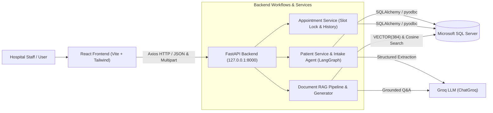
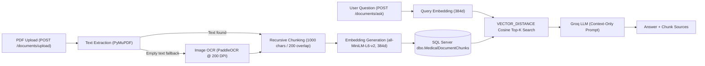
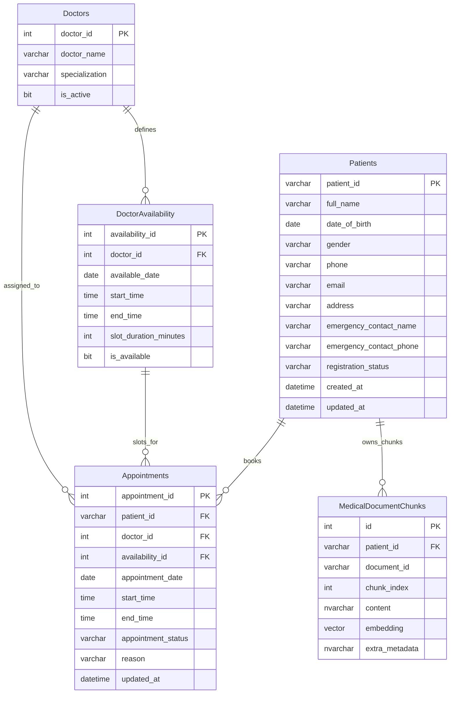

# Hospital Operations AI Design

An AI-assisted hospital administration and clinical document intelligence platform built with **FastAPI**, **React**, **SQL Server**, **LangGraph**, and **Retrieval-Augmented Generation (RAG)**.

The system streamlines core outpatient administrative workflows—conversational patient intake, conflict-free appointment scheduling, doctor availability tracking, and grounded Q&A over uploaded clinical PDFs.

> **Scope Notice:** This repository is a technical architecture and engineering demonstration project using synthetic patient data. It is not intended for production clinical deployment or real protected health information (PHI).

---

## Table of Contents

- [Project Overview](#project-overview)
- [Implemented Features](#implemented-features)
- [Technology Stack](#technology-stack)
- [Architecture](#architecture)
- [Project Structure](#project-structure)
- [Installation and Setup (Windows)](#installation-and-setup-windows)
- [Environment Variables](#environment-variables)
- [API Documentation](#api-documentation)
- [Database Schema](#database-schema)
- [Testing](#testing)
- [Screenshots](#screenshots)
- [Future Improvements](#future-improvements)

---

## Project Overview

Hospital administrative desks handle repetitive coordination across patient registration, physician schedule matching, and reviewing multi-page medical PDFs. **Hospital Operations AI Design** brings these workflows together:

- **Backend (`Backend/`)**: A FastAPI service layer backed by Microsoft SQL Server (`pyodbc` + SQLAlchemy), transaction-safe appointment slot locking, a LangGraph conversational patient intake workflow, and a PDF OCR + SQL Server vector RAG pipeline.
- **Frontend (`Frontend/`)**: A React + Vite + Tailwind CSS operations dashboard featuring patient registration and lookup, real-time appointment booking and cancellation, doctor slot browsing, and a chat-style document intelligence workspace.

---

## Implemented Features

### 1. Patient Intake
- **Conversational Intake Graph** (`Backend/app/intake_agent/`): Uses LangGraph and Groq LLM (`ChatGroq`) to extract `name`, `date_of_birth`, and `phone_no` from natural-language messages.
- **Input Validation & Follow-ups**: Validates required fields, checks ISO date format (`YYYY-MM-DD`, strictly prior to today) and 10-digit phone format, and prompts the user for missing or invalid details.
- **Explicit Confirmation Gate**: Summarizes extracted patient fields and waits for explicit user confirmation (`Yes`/`No`) before persisting any record.
- **SQL Server Registration**: Inserts confirmed patients into `dbo.Patients` with generated UUID `patient_id` values; also exposed via `POST /patients/register` and the frontend registration modal.

### 2. Appointment Scheduling
- **Doctor Directory**: Retrieves active doctors and their specializations from `dbo.Doctors`.
- **Dynamic Slot Generation**: Expands `dbo.DoctorAvailability` windows using SQL Server recursive CTEs and `slot_duration_minutes`, excluding overlapping `BOOKED` appointments.
- **Concurrency-Safe Booking**: Prevents double booking via SQL Server transaction locks (`WITH (UPDLOCK, HOLDLOCK)`) and slot-alignment validation before inserting into `dbo.Appointments`.
- **Patient History & Cancellation**: Retrieves patient appointment history joined with doctor metadata and supports cancelling `BOOKED` appointments, releasing cancelled slots back into availability.

### 3. Document Intelligence (RAG)
- **PDF Ingestion (`POST /documents/upload`)**: Accepts `.pdf` uploads scoped to a `patient_id`.
- **Dual Text Extraction**: Extracts native text with **PyMuPDF** (`fitz`) and automatically falls back to **PaddleOCR** (`200 DPI` page rendering) for scanned or image-based PDFs.
- **Chunking & Embeddings**: Splits text via `RecursiveCharacterTextSplitter` (`chunk_size=1000`, `chunk_overlap=200`) and generates 384-dimensional embeddings with Sentence Transformers (`all-MiniLM-L6-v2`).
- **SQL Server Vector Storage & Retrieval**: Stores chunks and `VECTOR(384)` embeddings in `dbo.MedicalDocumentChunks` and performs cosine similarity search (`VECTOR_DISTANCE('cosine', ...)`).
- **Grounded Q&A (`POST /documents/ask`)**: Prompts Groq LLM (`ChatGroq`) to answer strictly from retrieved context without inventing values or giving diagnoses, returning the answer alongside source citations (`document_id`, `chunk_index`, `distance`).

### 4. AI Agent Architecture
- **LangGraph State Machine**: Organizes patient intake across `extract_information`, `validate_information`, `followup`, `prepare_confirmation`, `handle_confirmation`, and `register_patient` nodes.
- **Conversation Memory**: Uses LangGraph's `InMemorySaver` checkpointer keyed by `thread_id` to maintain multi-turn intake state across messages.
- **LLM Integration**: Uses `langchain-groq` (`ChatGroq`) for structured intake extraction and context-grounded RAG generation.

---

## Technology Stack

Verified directly against `pyproject.toml`, `requirements.txt`, `Backend/app/`, and `Frontend/package.json`:

| Layer | Technologies |
| :--- | :--- |
| **Backend API** | Python 3.13, FastAPI, Uvicorn, Pydantic, `python-multipart`, `email-validator`, `python-dotenv` |
| **Database & Vector Store** | Microsoft SQL Server (2025 `VECTOR(384)` & `VECTOR_DISTANCE`), SQLAlchemy, `pyodbc`, ODBC Driver 18 for SQL Server |
| **AI & Agent Orchestration** | LangGraph (`StateGraph`, `InMemorySaver`), LangChain, LangChain Text Splitters, Groq (`langchain-groq`) |
| **Document Processing & Embeddings** | PyMuPDF (`fitz`), PaddleOCR, PaddlePaddle, Sentence Transformers (`all-MiniLM-L6-v2`) |
| **Frontend UI** | React 18, Vite, Tailwind CSS, React Router, Axios, Lucide React, Recharts |

> **Vector Retrieval Note:** Vector similarity search is implemented directly in SQL Server using native `VECTOR(384)` columns and `VECTOR_DISTANCE('cosine', ...)` in `Backend/app/rag/vector_store.py` (FAISS is not used).

---

## Architecture

### High-Level System Architecture



### Document Intelligence (RAG) Pipeline



---

## Project Structure

```text
Hospital Operations AI Design/
├── Backend/
│   ├── app/
│   │   ├── api/
│   │   │   ├── appointments.py          # Doctor, slot, booking, history & cancellation routes
│   │   │   ├── documents.py             # PDF upload & RAG /ask routes
│   │   │   └── patients.py              # Patient registration route
│   │   ├── database/
│   │   │   ├── models/
│   │   │   │   └── patient.py           # SQLAlchemy dbo.Patients model
│   │   │   ├── base.py                  # DeclarativeBase
│   │   │   ├── connection.py            # SQL Server pyodbc engine & get_db dependency
│   │   │   └── models.py
│   │   ├── document_processing/
│   │   │   ├── extractor.py             # PyMuPDF text extraction
│   │   │   ├── ocr.py                   # PaddleOCR image text extraction
│   │   │   └── processor.py             # PDF extraction with OCR fallback
│   │   ├── intake_agent/
│   │   │   ├── graph.py                 # LangGraph StateGraph + InMemorySaver
│   │   │   ├── nodes.py                 # Extraction, validation, confirmation & DB registration
│   │   │   ├── prompts.py               # Intake extraction prompt
│   │   │   └── state.py                 # TypedDict state schema
│   │   ├── rag/
│   │   │   ├── chunking.py              # RecursiveCharacterTextSplitter config
│   │   │   ├── document_loader.py
│   │   │   ├── embedding.py             # SentenceTransformer all-MiniLM-L6-v2
│   │   │   ├── generator.py             # Groq RAG answer generator with source metadata
│   │   │   ├── pipeline.py              # End-to-end document ingestion pipeline
│   │   │   ├── retriever.py             # Similarity search wrapper
│   │   │   └── vector_store.py          # SQL Server VECTOR(384) insert & VECTOR_DISTANCE search
│   │   ├── services/
│   │   │   ├── appointment_service.py   # Slot generation, UPDLOCK booking, history & cancel
│   │   │   └── patient_service.py       # Patient registration persistence
│   │   └── main.py                      # FastAPI app, CORS middleware & router mounting
│   ├── storage/                         # Backend runtime PDF upload directory
│   └── tests/                           # Script-based service, intake & RAG checks
├── Docs/                                # Documentation assets folder
├── Frontend/
│   ├── src/
│   │   ├── components/
│   │   │   ├── appointments/
│   │   │   │   └── BookAppointmentModal.jsx
│   │   │   ├── doctors/
│   │   │   │   └── DoctorSlotsModal.jsx
│   │   │   ├── layout/
│   │   │   │   ├── Navbar.jsx
│   │   │   │   └── Sidebar.jsx
│   │   │   ├── patients/
│   │   │   │   ├── PatientDetailsModal.jsx
│   │   │   │   └── RegisterPatientModal.jsx
│   │   │   └── ui/                      # Button, DataTable, Modal, ConfirmDialog, StatCard, etc.
│   │   ├── hooks/                       # useDoctors, useToast, useWorkspaceData
│   │   ├── layouts/
│   │   │   └── DashboardLayout.jsx
│   │   ├── pages/                       # Dashboard, Patients, Appointments, Doctors, Documents, Settings
│   │   ├── services/                    # api.js, patientService, appointmentService, doctorService, documentService
│   │   ├── utils/                       # demoData, formatters, storage, validators
│   │   ├── App.jsx
│   │   ├── index.css
│   │   └── main.jsx
│   ├── index.html
│   ├── package.json
│   ├── postcss.config.js
│   ├── tailwind.config.js
│   └── vite.config.js
├── Storage/                             # Sample report PDF/PNG and uploaded PDFs
├── .gitignore
├── .python-version                      # Python 3.13
├── main.py
├── pyproject.toml
├── README.md
├── requirements.txt
└── uv.lock
```

---

## Installation and Setup (Windows)

### Prerequisites
- **Python 3.13+** (see `.python-version`)
- **Node.js 20+** and **npm**
- **Microsoft SQL Server 2025** (with `VECTOR` data type support) and **ODBC Driver 18 for SQL Server**
- A **Groq API key**

### 1. Clone the repository
```powershell
git clone <your-repository-url>
cd "Hospital Operations AI Design"
```

### 2. Create and activate a Python virtual environment
```powershell
python -m venv .venv
.\.venv\Scripts\Activate.ps1
```

### 3. Install backend dependencies
```powershell
pip install -r requirements.txt
```
*(Alternatively, if using `uv`: `uv sync`.)*

### 4. Configure environment variables
This repository does not currently include a `.env.example` file. Create a `.env.example` template (for version control) and a local `.env` file in the project root with your local values:

```powershell
Copy-Item .env.example .env
```

See the [Environment Variables](#environment-variables) section below for the safe `.env.example` template.

### 5. Configure the SQL Server database
1. Start your SQL Server instance (for example `localhost\SQLEXPRESS`) with Windows Authentication enabled.
2. Create the target database (e.g., `HospitalAI`) and ensure the tables `dbo.Patients`, `dbo.Doctors`, `dbo.DoctorAvailability`, `dbo.Appointments`, and `dbo.MedicalDocumentChunks` exist (see [Database Schema](#database-schema)).
3. Verify connectivity from the `Backend` directory:
   ```powershell
   cd Backend
   ..\.venv\Scripts\python.exe -m app.database.connection
   ```

### 6. Run the FastAPI backend
Run Uvicorn from inside `Backend/` so `app.*` imports resolve properly:
```powershell
cd Backend
..\.venv\Scripts\uvicorn.exe app.main:app --host 127.0.0.1 --port 8000 --reload
```
The backend listens at `http://127.0.0.1:8000`.

### 7. Install frontend dependencies
Open a new terminal at the repository root:
```powershell
cd Frontend
npm install
```

### 8. Run the React development server
```powershell
cd Frontend
npm run dev
```
Open `http://127.0.0.1:5173` (or `http://localhost:5173`) in your browser.

---

## Environment Variables

Recommended `.env.example` contents (safe placeholders—never commit real secrets or `.env` files):

```dotenv
DB_DRIVER=ODBC Driver 18 for SQL Server
DB_SERVER=localhost\SQLEXPRESS
DB_NAME=HospitalAI
GROQ_API_KEY=your_groq_api_key_here
GROQ_MODEL=openai/gpt-oss-20b
```

| Variable | Required | Purpose | Example Placeholder |
| :--- | :--- | :--- | :--- |
| `DB_DRIVER` | Yes | ODBC driver passed to SQLAlchemy/pyodbc connection string | `ODBC Driver 18 for SQL Server` |
| `DB_SERVER` | Yes | SQL Server host and instance name | `localhost\SQLEXPRESS` |
| `DB_NAME` | Yes | SQL Server database name | `HospitalAI` |
| `GROQ_API_KEY` | Yes | API key used by `ChatGroq` in intake and RAG workflows | `your_groq_api_key_here` |
| `GROQ_MODEL` | No | Groq model ID (defaults to `openai/gpt-oss-20b` in `generator.py`) | `openai/gpt-oss-20b` |
| `VITE_API_BASE_URL` | No | Optional frontend Axios override (defaults to `http://127.0.0.1:8000`) | `http://127.0.0.1:8000` |

---

## API Documentation

When FastAPI is running, interactive API docs are available at:
- **Swagger UI**: `http://127.0.0.1:8000/docs`
- **ReDoc**: `http://127.0.0.1:8000/redoc`

### Endpoint Summary

| Method | Endpoint | Purpose |
| :--- | :--- | :--- |
| `GET` | `/` | Verify backend service is running |
| `POST` | `/patients/register` | Register a new patient in SQL Server |
| `GET` | `/appointments/doctors` | List doctors and specializations |
| `GET` | `/appointments/available` | Retrieve available appointment slots |
| `POST` | `/appointments/book` | Book an appointment slot |
| `GET` | `/appointments/patient/{patient_id}` | Retrieve patient appointment history |
| `PATCH` | `/appointments/{appointment_id}/cancel` | Cancel an active booked appointment |
| `POST` | `/documents/upload` | Upload and ingest a PDF document into RAG |
| `POST` | `/documents/ask` | Ask a question over a patient's uploaded PDFs |

*(Note: `Backend/app/main.py` defines `health_check()` at line 50 without the `@` decorator syntax, so `GET /` is the active status endpoint.)*

---

### Patients

#### `POST /patients/register`
Registers a patient in `dbo.Patients`.

**Request Body (`PatientRegistrationRequest`):**
```json
{
  "full_name": "Demo Patient",
  "date_of_birth": "1995-03-15",
  "gender": "Male",
  "phone": "9876543210",
  "email": "demo.patient@example.com",
  "address": "100 Sample Clinic Way",
  "emergency_contact_name": "Demo Contact",
  "emergency_contact_phone": "9876500000"
}
```
Required fields: `full_name`, `date_of_birth` (`YYYY-MM-DD`), `phone`. All other fields are optional (`null`).

**Response (`200 OK`):**
```json
{
  "message": "Patient registered successfully",
  "patient_id": "550e8400-e29b-41d4-a716-446655440000",
  "full_name": "Demo Patient",
  "registration_status": "REGISTERED"
}
```

---

### Appointments & Doctors

#### `GET /appointments/doctors`
Lists doctors from `dbo.Doctors`.

**Response (`200 OK`):**
```json
{
  "total_doctors": 2,
  "doctors": [
    {
      "doctor_id": 1,
      "doctor_name": "Dr. A. Mehta",
      "specialization": "Cardiology"
    }
  ]
}
```

#### `GET /appointments/available`
Query parameters:
- `appointment_date` (`date`, required, `YYYY-MM-DD`)
- `doctor_id` (`int`, optional)

**Response (`200 OK`):**
```json
{
  "total_slots": 1,
  "available_slots": [
    {
      "doctor_id": 1,
      "doctor_name": "Dr. A. Mehta",
      "specialization": "Cardiology",
      "availability_id": 10,
      "available_date": "2026-11-25",
      "slot_start": "09:00:00",
      "slot_end": "09:30:00"
    }
  ]
}
```

#### `POST /appointments/book`
**Request Body (`AppointmentBookingRequest`):**
```json
{
  "patient_id": "550e8400-e29b-41d4-a716-446655440000",
  "doctor_id": 1,
  "availability_id": 10,
  "appointment_date": "2026-11-25",
  "start_time": "09:00:00",
  "reason": "Routine consultation"
}
```

**Response (`200 OK`):**
```json
{
  "message": "Appointment booked successfully",
  "appointment": {
    "appointment_id": 42,
    "appointment_status": "BOOKED",
    "appointment_date": "2026-11-25",
    "start_time": "09:00:00",
    "end_time": "09:30:00"
  }
}
```
Returns `409 Conflict` if the slot is outside doctor availability, misaligned, or already booked.

#### `GET /appointments/patient/{patient_id}`
**Response (`200 OK`):**
```json
{
  "patient_id": "550e8400-e29b-41d4-a716-446655440000",
  "total_appointments": 1,
  "appointments": [
    {
      "appointment_id": 42,
      "patient_id": "550e8400-e29b-41d4-a716-446655440000",
      "doctor_name": "Dr. A. Mehta",
      "specialization": "Cardiology",
      "appointment_date": "2026-11-25",
      "start_time": "09:00:00",
      "end_time": "09:30:00",
      "appointment_status": "BOOKED",
      "reason": "Routine consultation"
    }
  ]
}
```

#### `PATCH /appointments/{appointment_id}/cancel`
Cancels an appointment where `appointment_status = 'BOOKED'`. Returns `404 Not Found` if not found or not currently booked.

**Response (`200 OK`):**
```json
{
  "message": "Appointment cancelled successfully",
  "appointment": {
    "appointment_id": 42,
    "appointment_status": "CANCELLED"
  }
}
```

---

### Document Intelligence

#### `POST /documents/upload`
Content-Type: `multipart/form-data`
- `file`: `.pdf` file (required)
- `patient_id`: string (required)

**Response (`200 OK`):**
```json
{
  "patient_id": "P003",
  "document_id": "9b1deb4d-3b7d-4bad-9bdd-2b0d7b3dcb6d",
  "total_chunks": 5,
  "status": "success"
}
```

#### `POST /documents/ask`
**Request Body (`QuestionRequest`):**
```json
{
  "patient_id": "P003",
  "question": "What is the patient's hemoglobin level?"
}
```

**Response (`200 OK`):**
```json
{
  "answer": "The patient's hemoglobin level is 13.5 g/dL.",
  "sources": [
    {
      "document_id": "9b1deb4d-3b7d-4bad-9bdd-2b0d7b3dcb6d",
      "chunk_index": 0,
      "distance": 0.2418
    }
  ]
}
```

---

## Database Schema

The backend interacts with five SQL Server tables under the `dbo` schema:

1. **`dbo.Patients`** (`Backend/app/database/models/patient.py`): Stores patient demographics (`patient_id`, `full_name`, `date_of_birth`, `gender`, `phone`, `email`, `address`, `emergency_contact_name`, `emergency_contact_phone`, `registration_status`, `created_at`, `updated_at`).
2. **`dbo.Doctors`** (`Backend/app/services/appointment_service.py`): Stores physicians (`doctor_id`, `doctor_name`, `specialization`, `is_active`).
3. **`dbo.DoctorAvailability`** (`Backend/app/services/appointment_service.py`): Stores doctor schedule blocks and slot durations (`availability_id`, `doctor_id`, `available_date`, `start_time`, `end_time`, `slot_duration_minutes`, `is_available`).
4. **`dbo.Appointments`** (`Backend/app/services/appointment_service.py`): Stores booked and cancelled appointments (`appointment_id`, `patient_id`, `doctor_id`, `availability_id`, `appointment_date`, `start_time`, `end_time`, `appointment_status`, `reason`, `updated_at`).
5. **`dbo.MedicalDocumentChunks`** (`Backend/app/rag/vector_store.py`): Stores chunked PDF text and `VECTOR(384)` embeddings (`id`, `patient_id`, `document_id`, `chunk_index`, `content`, `embedding`, `extra_metadata`).



---

## Testing

The `Backend/tests/` directory contains runnable Python test scripts that exercise the database services, LangGraph intake workflow, and RAG pipeline using **synthetic sample data** (such as `"Rahul Sharma"`, `"P001"`, `"P002"`, `"P003"`, and `Storage/sample_report.pdf`).

Run these scripts from the `Backend/` directory with SQL Server running and `.env` configured:

| Script | Purpose | Command |
| :--- | :--- | :--- |
| `test_appointment_service.py` | Lists available slots for a doctor and date | `..\.venv\Scripts\python.exe -m tests.test_appointment_service` |
| `test_book_appointment.py` | Books a sample appointment slot | `..\.venv\Scripts\python.exe -m tests.test_book_appointment` |
| `test_intake_graph.py` | Single-turn LangGraph intake extraction & validation | `..\.venv\Scripts\python.exe -m tests.test_intake_graph` |
| `test_intake_conversation.py` | Multi-turn LangGraph conversation with confirmation | `..\.venv\Scripts\python.exe -m tests.test_intake_conversation` |
| `test_vector.py` | Chunking, embedding, SQL vector insert & cosine search | `..\.venv\Scripts\python.exe -m tests.test_vector` |
| `test_pipeline.py` | End-to-end PDF ingestion (`ragpipeline`) | `..\.venv\Scripts\python.exe -m tests.test_pipeline` |
| `test_retriever.py` | Vector similarity retrieval for `"P001"` | `..\.venv\Scripts\python.exe -m tests.test_retriever` |
| `test_generator.py` | RAG answer generation for `"P001"` | `..\.venv\Scripts\python.exe -m tests.test_generator` |
| `test_full_rag.py` | Combined PDF ingestion + RAG Q&A flow (`"P003"`) | `..\.venv\Scripts\python.exe -m tests.test_full_rag` |

*(Note: `test_intake_graph.py` and `test_intake_conversation.py` execute at module import time rather than as `pytest` assertions, so running them via `python -m tests.<module>` is recommended.)*

To verify the frontend production bundle:
```powershell
cd Frontend
npm run build
```

---

## Screenshots

> Screenshot placeholders below reference `docs/images/*.png`. Add captured UI screenshots at those paths when ready.

- **Dashboard Overview**
  

- **Patient Intake & Directory**
  

- **Appointment Scheduling & Slot Selection**
  

- **Doctor Directory & Availability**
  

- **Document Intelligence (PDF Upload & RAG Q&A)**
  

---

## Future Improvements

The following items represent planned enhancements and are **not yet implemented**:

- **Conversational Intake REST/WebSocket Endpoint**: Expose `intake_graph` (`Backend/app/intake_agent/`) over an API route so staff can use chat-driven patient intake directly inside the React UI.
- **Read & Listing Endpoints**: Add `GET /patients`, `GET /appointments`, and `GET /documents` endpoints to replace browser-session persistence and synthetic dashboard demo baselines with full database queries.
- **Authentication & Role-Based Access Control (RBAC)**: Wire JWT login and role permissions across hospital admin, receptionist, and clinician personas (supporting libraries like `python-jose` and `passlib` are already listed in `requirements.txt`).
- **Appointment Reminders**: Automated SMS or email notifications prior to scheduled consultations.
- **Automated CI Test Suite & Observability**: Add unit/integration `pytest` suites with mocked SQL Server/LLM dependencies and structured `loguru` request logging.

